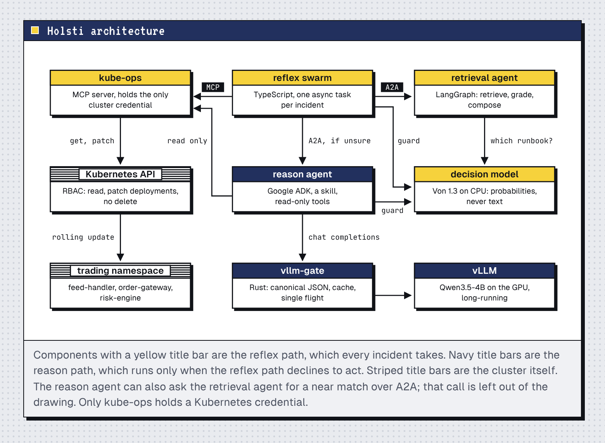
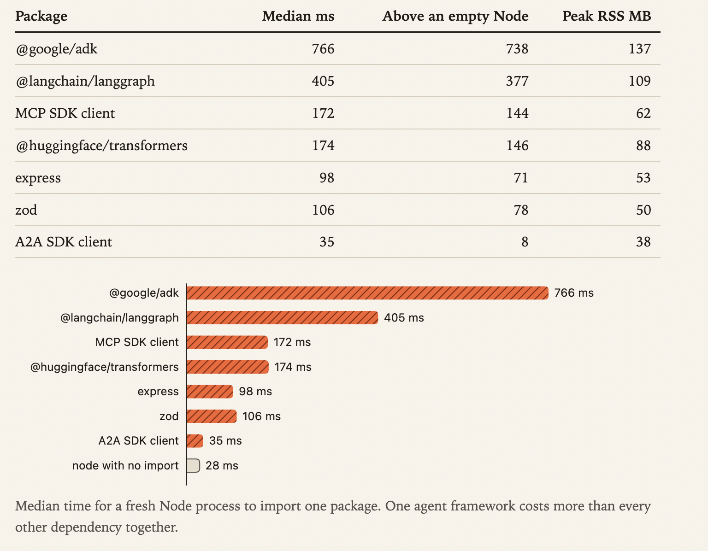

# Reflex and Reason 1.0

An on-call triage system for a Kubernetes cluster. A decision model on CPU
matches a fault to a runbook, a guarded MCP tool applies the fix, and a
language model is consulted only when nothing known fits. The agents are
TypeScript. Three small Rust programs sit where measurements said they had
to: a front door for alert bursts, a proxy in front of vLLM, and a helper
that measures cold starts.

Architecture:

Latency:


The full explanation, with every listing and every number, is
`docs/reflex-reason-tutorial.html`.

## Quick start (no GPU needed)

```
scripts/00-prereqs.sh                  # what is installed, changes nothing
./build.sh                             # test, compile, bundle, package
YES=1 scripts/10-k3s-up.sh             # single-node cluster (system service)
kubectl apply -f deploy/scenarios/trading.yaml \
              -f deploy/k8s/00-oncall-rbac.yaml
pip install 'von-sdk>=1.3.7'
von serve --host 127.0.0.1 --port 8100 --device cpu --model von-1.3 &
ACTION_BUDGET=100 MOCK_LLM=1 scripts/40-dev-up.sh &
scripts/50-eval.sh                     # ten fault scenarios, checked
```

To break one thing and watch one response:

```
scripts/30-inject.sh crash-config
. ./.dev.env && node ts/dist/bundle/swarm.mjs --once
scripts/30-inject.sh reset
```

## With the GPU

```
scripts/15-fetch-model.sh              # Qwen/Qwen3.5-4B into the pod's cache
GPU=1 scripts/20-deploy.sh             # everything as pods, vLLM included
scripts/63-bench-vllm-prefix.sh        # what the gateway is worth to vLLM
```

The vLLM path was prepared from the model's recipe and was not run on the
machine that produced the shipped numbers, which has no GPU. The tutorial's
last chapter lists every such gap and the command that closes it.

## Measure on your machine

```
scripts/60-bench.sh                    # cold start, throughput, gateway,
                                       # chunking, swarm memory, decisions
scripts/45-door-check.sh > bench/results/door.json
scripts/65-record-build.sh             # needs Docker
python3 docs/build_tutorial.py         # the tutorial, from your results
```

The tutorial contains no measured number typed by hand. It is generated
from `bench/results/*.json`, and the generator stops if a result is missing.

## Layout

| Path | Content |
|---|---|
| `rust/crates/sift` | log distiller, a library with no dependencies |
| `rust/crates/intake` | front door: command line and AWS Lambda bootstrap |
| `rust/crates/vllm-gate` | proxy for vLLM: canonical JSON, cache, single flight |
| `rust/crates/rusage` | measures a child process for the benchmarks |
| `ts/src/reflex`, `ts/src/swarm` | reflex agent, policy, dispatcher |
| `ts/src/mcp`, `ts/src/kube` | the kube-ops MCP server and its Kubernetes calls |
| `ts/src/rag` | ingest, embed, search, LangGraph graph, A2A server |
| `ts/src/reason` | ADK agent and the OpenAI-compatible model adapter |
| `runbooks/` | eight procedures in Markdown |
| `deploy/` | trading stand-in, manifests, Dockerfiles, SAM template |
| `scripts/` | numbered in the order they are used |
| `bench/` | harnesses and `results/` |

## Safety properties, in one place

No tool and no Role contains a delete. Writes are three reversible actions
on Deployments in one namespace, at most three per workload in ten minutes.
The agent that reads untrusted text holds no write token and is offered no
write tool. `SHADOW=1` on the MCP server turns every write into a
server-side dry run.

Licensed under Apache-2.0.
